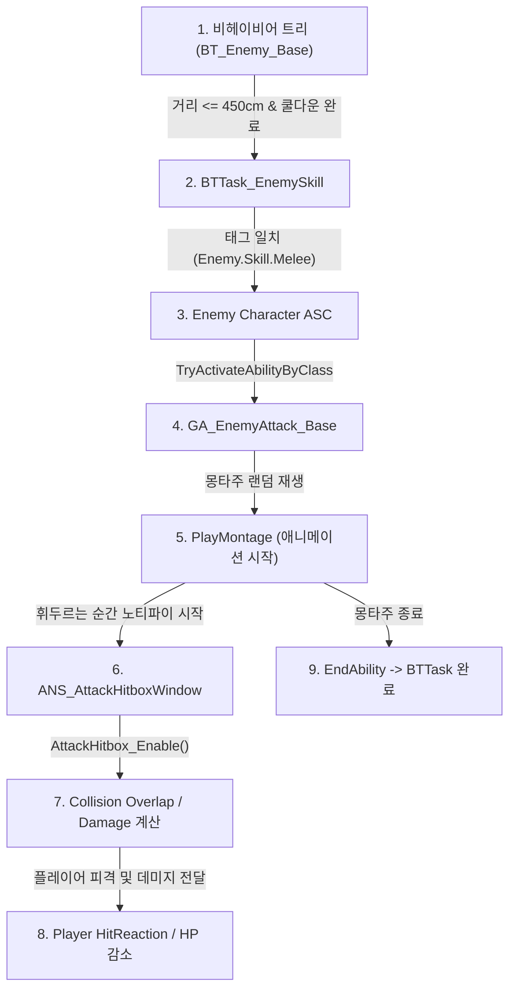

# 적(몬스터) & 보스 제작 및 스폰 세팅 종합 가이드 (Enemy_Setup_Guide)

---

## 1. 개요 및 스폰 방식 결정 (스포너 vs 직접 배치)

본 프로젝트에서 적(몬스터 및 보스)을 월드에 등장시키는 방식은 게임 기획에 따라 아주 명확하게 구분됩니다:

| 구분 | 추천 스폰 방식 | 세팅 위치 | 리젠(리스폰) 동작 |
| :--- | :--- | :--- | :--- |
| **일반 필드/던전 잡몹** | **`EnemySpawner` (스포너)** | 스포너의 `EnemyDataAsset`에만 등록 | 사망 후 설정된 주기(`RespawnDelay`)마다 자동 무한 리필 |
| **필드 레이드 보스** | **`EnemySpawner` (스포너)** | 스포너의 `EnemyDataAsset`에 `BossDataAsset` 등록 (`InitialCount = 1`, `MaxAlive = 1`) | 보스가 죽고 일정 시간(예: 30분, 1시간 등) 후 다시 등장 |
| **인스턴스 던전 보스** | **레벨 직접 배치 (Direct Placement)** | 보스 BP 디테일 패널의 `BossData`에 할당 | 1회성 처치 (던전 입장 시 1회 클리어용, 리젠 없음) |

> 💡 **핵심 통일 규칙**:
> - **스포너를 사용할 때**: 몬스터/보스 블루프린트(`BP_EnemyBase`, `BP_Boss_Golem` 등) 자체에는 `EnemyData`를 비워두셔도 됩니다! 스포너가 몬스터를 스폰할 때 해당 데이터 에셋의 스탯, 드랍 테이블, 보스 페이즈 스킬을 C++에서 100% 자동으로 주입해 줍니다.
> - **직접 배치할 때**: 스포너가 없으므로 몬스터/보스 BP의 디테일 패널에서 `EnemyData` 또는 `BossData`를 직접 넣어주시면 됩니다.

---

## 2. 몬스터 공격 실행 파이프라인 (Execution Pipeline)

1. **비헤이비어 트리 (`BT_Enemy_Base`)**:
   - `BTService_UpdateTarget`이 매 틱 타겟과의 거리(`DistanceToTarget`)를 계산.
   - 타겟이 450cm 이내이고 공격 쿨다운이 끝나면 `Sequence_Melee` 시퀀스로 진입.
2. **어빌리티 발동 (`BTTask_EnemySkill`)**:
   - 적의 ASC에서 `Enemy.Skill.Melee` 태그를 가진 어빌리티(`GA_EnemyAttack_Base`)를 찾아 발동.
   - 동시에 적에게 `State.Attacking` 태그가 부여되어 회전 잠금 및 피격 슈퍼아머 적용.
3. **몽타주 재생 (`GA_EnemyAttack_Base`)**:
   - `AttackMontages` 배열에 등록된 애니메이션 몽타주 중 하나를 랜덤 재생.
   - (설정된 경우) `MotionWarpingComponent`로 플레이어 방향으로 전진/점프.
4. **타격 판정 (`ANS_AttackHitboxWindow`)**:
   - 몽타주 트랙의 타격 구간에 배치된 `ANS_AttackHitboxWindow`가 켜지면 몬스터의 `AttackHitbox` 콜리전이 활성화.
   - 플레이어 캡슐과 겹치면(`Overlap`) 방어력 감쇄 공식을 거쳐 최종 데미지 및 경직 적용.
5. **어빌리티 종료 & BT 복귀**:
   - 몽타주가 끝나면 어빌리티가 종료(`EndAbility`)되고, 비헤이비어 트리가 다음 행동(이동/대기/쿨다운)으로 복귀.

---

## 3. 적(몬스터) 세팅 초간단 2단계 파이프라인 (가장 편한 방식!)

몬스터를 만드실 때 어디에 뭘 넣어야 할지 절대 헷갈리지 않도록 **완벽하게 분리**했습니다:
* **블루프린트(BP)** = **외형/뼈대 (3D 몸체)** 만 담당 (1번 만들고 닫음)
* **데이터 테이블(DT)** = **스펙/밸런스/애니메이션 (내용물)** 을 엑셀처럼 한 표에서 관리

---

### [1단계] 몬스터 블루프린트 만들기 (`BP_EnemyBase` 자식) - 소요시간: 1분
1. `BP_EnemyBase` 우클릭 ➔ **자식 블루프린트 생성** (예: `BP_Goblin`).
2. 에디터를 열고 딱 **2가지만** 맞추고 저장 후 닫으시면 됩니다:
   - **Mesh & Anim Class**: 몬스터의 3D 스켈레탈 메시와 애님 블루프린트 지정.
   - **AttackHitbox 콜리전**: 손이나 무기 소켓에 `BoxComponent` 추가 후 태그에 **`AttackHitbox`** 입력.
3. 💡 **스탯, 공격력, 사정거리, 스킬 등은 BP에서 손댈 필요가 전혀 없습니다!**

---

### [2단계] 데이터 테이블(`DT_EnemyData`)
`DT_EnemyData`를 더블클릭해서 열고 **[추가(+)]** 버튼을 누른 뒤 표에 입력합니다:

| 항목 | 입력 내용 | 설명 |
| :--- | :--- | :--- |
| **Row Name** | `Goblin_01` | 고유 식별 키 (스포너 드롭다운 목록에 뜨는 이름) |
| **Name** | `고블린 병사` | 인게임 UI에 표시될 한글 이름 |
| **EnemyClass** | `BP_Goblin` | [1단계]에서 만든 자식 블루프린트 지정 |
| **MaxHP / Attack / Defense** | `150 / 15 / 5` | 체력, 공격력, 방어력 밸런스 수치 |
| **AttackRange** | `250.0` | 평타 공격 사정거리 (단검 220, 검 280, 대형 400) |
| **AttackDamageType** | `Physical` | 공격 속성 (Physical: 물리, Magical: 마법, Fire: 화염 등) |
| **AggroStyle** | `Preemptive` | 선공/비선공 (Preemptive: 선공 몬스터, Reactive: 맞아야 반격) |
| **CombatRunSpeed** | `400.0` | 전투 시 플레이어를 추적하는 달리기 속도 (기본 400, 빠른 늑대 550) |
| **PatrolWalkSpeed** | `200.0` | 평상시 순찰 걷기 속도 (기본 200) |
| **AttackMontages** | `AM_Goblin_Attack_01` | 공격 모션 몽타주 등록 (공용 GA가 자동 재생) |
| **DropList** | 골드, 가죽 등 | 전리품 드랍 목록 |
| **GrantedSkills** | *(비워둠)* | 일반 적은 비워둡니다 (특수 스킬이 있는 엘리트/보스만 지정) |
| **BossPhaseData** | *(None)* | 보스인 경우에만 페이즈 DA 연결, 일반 적은 None |

---

## 4. 스포너(`EnemySpawner`) 배치 및 필드 세팅 방법

스포너는 복잡한 입력창 없이, **데이터 테이블 단일 방식**으로 작동합니다.

1. 레벨 에디터에서 `EnemySpawner` 액터를 원하는 필드 위치에 드래그&드롭으로 배치합니다.
2. 디테일 패널의 **Spawn** 카테고리에서 딱 2가지만 설정합니다:
   - **Enemy Data Table**: `DT_EnemyData` 할당.
   - **Enemy Row Name**: 드롭다운(▼) 목록에서 스폰할 몬스터(예: `Goblin_01`, `Wolf_01`, `Boss_Golem`)를 클릭 선택!
3. 스폰 수량 및 리젠 옵션:
   - **Initial Count**: 시작 시 스폰할 마릿수 (일반 몬스터: 3~5마리 / 보스: 1마리).
   - **Max Alive**: 유지할 최대 마릿수 (일반 몬스터: 5~8마리 / 보스: 1마리).
   - **Respawn Delay**: 사망 후 부활 딜레이(초) (일반 몬스터: 5~10초 / 필드 보스: 1800초 등).
   - **Spawn Radius**: 스포너 중심 원형 반경 (기본 800cm).
   - **Auto Refill**: 체크 (마릿수가 줄어들면 자동 리필).

---

## 5. 보스 몬스터 세팅 (필드 리젠 보스 vs 던전 직접 배치 보스)

보스 역시 `DT_EnemyData` 표의 행으로 등록되어 있으므로 동일한 방식으로 세팅됩니다:

### 📌 Case A: 필드 레이드 보스 (주기적 리젠)
- **세팅법**:
  1. 레벨에 `EnemySpawner`를 배치합니다.
  2. `Enemy Data Table`에 `DT_EnemyData`를 넣고, `Enemy Row Name`에서 보스(예: `Boss_Golem`)를 드롭다운으로 선택합니다.
  3. `InitialCount = 1`, `MaxAlive = 1` 로 설정합니다.
  4. `RespawnDelay`에 원하는 리젠 시간(예: 1800초 = 30분)을 설정합니다.
  5. 💡 **완료**: 보스가 사망 후 루팅 타임이 지나면 시체가 사라지고, 지정된 시간 뒤에 다시 리젠됩니다!

### 📌 Case B: 인스턴스 던전 보스 (레벨 직접 배치, 1회 처치용)
- **세팅법**:
  1. 보스 룸에 보스 블루프린트(예: `BP_Boss_Golem`)를 직접 드래그해서 배치합니다.
  2. 보스 액터 디테일 패널의 **Config** 카테고리에서:
     - **Enemy Data Table**: `DT_EnemyData` 할당.
     - **Enemy Row Name**: 드롭다운(▼)에서 `Boss_Golem` 선택!
  3. 💡 **완료**: 던전 진입 시 표에 적힌 스탯, 드랍템, 페이즈 데이터가 자동으로 주입되며 플레이어가 다가가면 보스 체력바 UI가 켜집니다.

